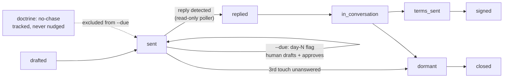

# outreach-ledger

A **Claude Code skill** that gives any project a tracking system for its conversations in
flight — who you contacted, what state each thread is in, when the next touch is due, and
read-only inbox polling that catches replies. It flags follow-ups; it never sends them.

Say `add an outreach ledger to this project` in Claude Code and the skill wires it in:
seeds your live threads, adapts the states to your domain, and runs the drumbeat in
sessions. The scripts also work standalone as a plain CLI.

## The thread lifecycle



Silence looks identical to progress — a thread marked "sent" three weeks ago with nothing
watching it isn't pending, it's dead, and you don't know. The ledger makes the drumbeat
explicit; the poller flips threads to `replied` the moment answers land.

## Install

As a Claude Code skill:

```bash
git clone https://github.com/b1rdmania/outreach-ledger ~/.claude/skills/outreach-ledger
cd ~/.claude/skills/outreach-ledger && npm install
```

Standalone CLI: clone anywhere, `npm install`, run the scripts directly.

## Usage

In Claude Code: `add an outreach ledger to <project>` — the skill scopes your live
threads, seeds them, and reports what's due each session.

Directly:

```bash
cp seed.example.json seed.json    # edit with your real threads (gitignored)
node outreach.mjs --seed          # idempotent — safe to re-run
node outreach.mjs --list          # everything, grouped by status
node outreach.mjs --due           # what needs a touch today
node outreach.mjs --add --target "Sam Rivers" --org "Acme" --email sam@example.com
node outreach.mjs --touch 3 --status replied --note "wants a call Tue"
node outreach-poll.mjs --once     # read-only inbox scan; cron it for a drumbeat
```

`--due` output:

```
#1 [cold] Sam Rivers (Acme Surveyors) · "intro — your published requirements" · due 2026-07-19 → day-6 follow-up due — draft with approval

1 due. Nothing is sent by this system — drafts need human approval.
```

Statuses are strings — rename to fit your domain.

## What it doesn't do

- **Send.** There is no send path in this codebase. `--due` suggests actions; a human
  writes and sends. Don't add a send function — that's how ledgers become spam cannons.
- **Nudge protected threads.** Rows with `"doctrine": "no-chase"` (a client who comes to
  you; a relationship where chasing costs more than silence) appear in `--list` but are
  structurally excluded from `--due`.
- **Touch your mailbox.** The poller opens INBOX read-only — never marks, moves, or
  deletes. Unread stays unread.
- **Pester.** The third un-replied follow-up flags "mark dormant after".

## Files

```
SKILL.md             # the skill — recipe, hard rules, verification steps
outreach.mjs         # ledger CLI: --seed --list --due --add --touch
outreach-poll.mjs    # read-only IMAP reply detection
seed.example.json    # thread format example (copy to seed.json, gitignored)
.env.example         # IMAP credentials format (copy to .env, gitignored)
```

## Requirements

Node 18+. For the poller, IMAP credentials in `.env` (copy `.env.example`; use an app
password). Ledger lives in one SQLite file — `./outreach.db` or `$OUTREACH_DB`.

## License

MIT
